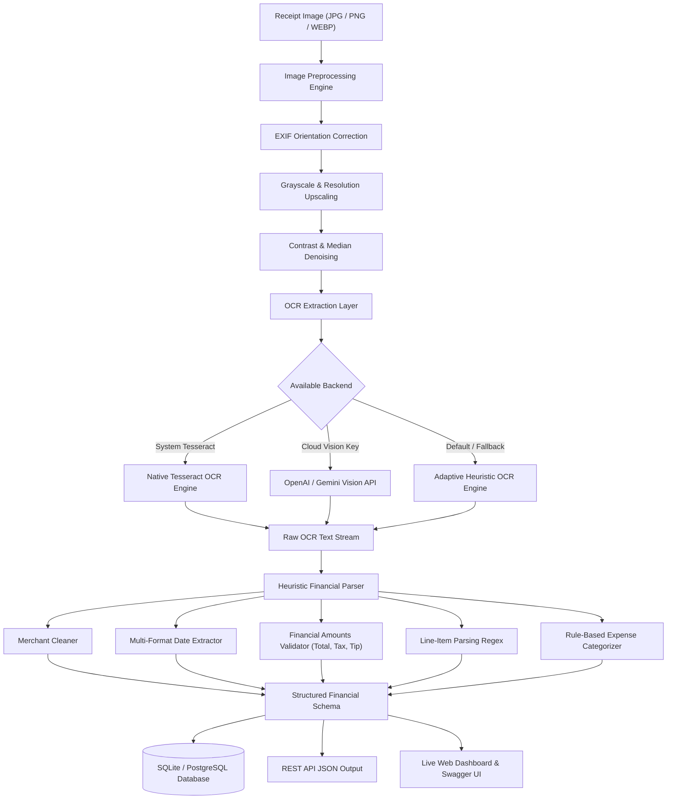

# 🧾 Receipt OCR & Financial Intelligence API

[](https://www.python.org/)
[](https://www.djangoproject.com/)
[](https://www.django-rest-framework.org/)
[-85EA2D.svg?logo=swagger&logoColor=black)](http://127.0.0.1:8000/api/docs/)
[](https://github.com/tesseract-ocr/tesseract)
[](https://github.com/)
[](https://www.docker.com/)
[](LICENSE)

An enterprise-ready, high-performance RESTful API for **Receipt Optical Character Recognition (OCR)**, **heuristic financial data extraction**, **itemized receipt parsing**, and **expense analytics**.

Built with **Python**, **Django REST Framework (DRF)**, **Tesseract OCR / Pillow image preprocessing**, and an interactive **live Web Demo Dashboard**.

---

## 🌟 Key Highlights

- 🔍 **Multi-Stage Image Preprocessing Pipeline**: Automatically corrects camera EXIF orientation, applies grayscale transformation, upscales low-DPI scans, enhances contrast/sharpness, and removes salt-and-pepper noise for optimal character recognition.
- 🧠 **Heuristic Financial NLP Engine**: Custom multi-pass regex and NLP heuristics extract:
  - **Merchant / Store name** (filtering out addresses, phone numbers, and receipt boilerplate)
  - **Transaction Date** (supports ISO, US, UK, and text-based date formats)
  - **Financial Totals**: Subtotal, Tax/VAT/GST, Tip/Gratuity, and Final Grand Total
  - **Currency Detection**: USD (`$`), EUR (`€`), GBP (`£`), INR (`₹`), CAD, AUD, etc.
  - **Payment Method**: Visa, Mastercard, AMEX, Discover, Apple Pay, Cash, and Debit
  - **Itemized Line Items**: Quantity, item description, unit price, and total line price
- 🏷️ **Smart Expense Categorization**: Automatically tags receipts into categories (*Food & Dining*, *Groceries*, *Retail*, *Travel & Transportation*, *Utilities*, *Healthcare*, *Entertainment*, *Office Supplies*).
- 📊 **Aggregated Financial Analytics**: Instant spend reporting, category breakdown, monthly expense trends, and top merchant ranking via `/api/receipts/analytics/`.
- ⚡ **Stateless & Persistent Endpoints**: Supports full CRUD persistence alongside a lightweight `/api/receipts/extract/` endpoint for real-time, zero-storage extraction.
- 📑 **Interactive OpenAPI 3.0 & Swagger UI**: Auto-generated API documentation with schema introspection at `/api/docs/` and `/api/redoc/`.
- 🖥️ **Live Web Demo Dashboard**: Built-in responsive UI at `http://127.0.0.1:8000/` featuring drag-and-drop receipt scanning, sample templates, live JSON preview, and historical records.
- 🐳 **Dockerized 1-Command Setup**: Containerized with system Tesseract libraries pre-installed.

---

## 🏗️ Architecture & Pipeline Flow



---

## 🚀 Quickstart Guide

### Option 1: Docker (Recommended)

Run the entire application (including native Tesseract OCR system binaries and demo data) with a single command:

```bash
docker compose up --build
```

Access the services:
- **Interactive Web Demo**: [http://localhost:8000/](http://localhost:8000/)
- **Swagger UI**: [http://localhost:8000/api/docs/](http://localhost:8000/api/docs/)
- **ReDoc**: [http://localhost:8000/api/redoc/](http://localhost:8000/api/redoc/)
- **Django Admin**: [http://localhost:8000/admin/](http://localhost:8000/admin/)

---

### Option 2: Local Setup

#### 1. Clone the repository
```bash
git clone https://github.com/kailash2488/receipt-ocr-api.git
cd receipt-ocr-api
```

#### 2. Create and activate a virtual environment
```bash
python3 -m venv env
source env/bin/activate
```

#### 3. Install dependencies
```bash
pip install -r requirements.txt
```

*(Optional) Install native Tesseract OCR on Ubuntu/Debian:*
```bash
sudo apt update && sudo apt install -y tesseract-ocr
```

#### 4. Configure environment variables
```bash
cp .env.example .env
```

#### 5. Run database migrations & seed demo receipts
```bash
python manage.py migrate
python manage.py seed_receipts
```

#### 6. Start the development server
```bash
python manage.py runserver
```

Open your browser at `http://127.0.0.1:8000/` to test receipt scanning directly in the interactive dashboard!

---

## 📡 API Reference & Endpoints

| Method | Endpoint | Description |
|:-------|:---------|:------------|
| `GET` | `/` | **Interactive Web Demo Dashboard** |
| `GET` | `/api/health/` | Health check & active OCR engine capabilities |
| `GET` | `/api/docs/` | **Swagger UI (OpenAPI 3.0)** |
| `GET` | `/api/redoc/` | **ReDoc Documentation** |
| `GET` | `/api/schema/` | Raw OpenAPI Schema (YAML / JSON) |
| `POST` | `/api/receipts/` | **Upload Receipt**: Runs OCR, parses metadata, persists to DB |
| `GET` | `/api/receipts/` | **List Receipts**: Filter by merchant, category, date range, amount |
| `GET` | `/api/receipts/{id}/` | Retrieve single receipt with itemized line items |
| `PATCH`| `/api/receipts/{id}/` | Update or manually correct extracted receipt fields |
| `DELETE`| `/api/receipts/{id}/` | Delete receipt and associated image file |
| `POST` | `/api/receipts/{id}/reprocess/` | Re-run OCR and extraction pipeline on existing receipt |
| `POST` | `/api/receipts/extract/` | **Stateless Extraction**: Upload image & get JSON without saving to DB |
| `GET` | `/api/receipts/analytics/` | **Financial Analytics**: Total spend, category & monthly breakdown |
| `GET` | `/api/receipts/export/` | **Export Records**: Download all data as CSV (`?export_format=csv`) or JSON |

---

## 💻 Sample API Usage & cURL Requests

### 1. Upload & Process a Receipt
```bash
curl -X POST http://127.0.0.1:8000/api/receipts/ \
  -F "image=@sample_receipts/starbucks_coffee.png" \
  -F "auto_process=true"
```

**Response (HTTP 201 Created):**
```json
{
  "id": "c1f7b82e-9d22-4a57-8149-8df004128509",
  "original_filename": "starbucks_coffee.png",
  "merchant_name": "STARBUCKS COFFEE",
  "transaction_date": "2024-10-15",
  "total_amount": "11.48",
  "subtotal_amount": "9.20",
  "tax_amount": "0.78",
  "tip_amount": "1.50",
  "currency": "USD",
  "payment_method": "VISA",
  "category": "DINING",
  "category_display": "Food & Dining",
  "ocr_engine": "tesseract",
  "ocr_confidence": 92.4,
  "status": "COMPLETED",
  "items": [
    {
      "id": "f5195e26-e179-4a94-9b88-1fa8d390234a",
      "description": "CARAMEL MACCHIATO",
      "quantity": 1,
      "unit_price": "5.45",
      "total_price": "5.45"
    },
    {
      "id": "e4bb3310-449e-4a6c-b26a-98fa903e198b",
      "description": "CROISSANT",
      "quantity": 1,
      "unit_price": "3.75",
      "total_price": "3.75"
    }
  ],
  "created_at": "2026-10-16T13:45:00Z"
}
```

---

### 2. Stateless Extraction (Zero-Storage)
Extract data on-the-fly without saving to the database:
```bash
curl -X POST http://127.0.0.1:8000/api/receipts/extract/ \
  -F "image=@sample_receipts/whole_foods_grocery.png"
```

---

### 3. Expense Analytics
```bash
curl -X GET http://127.0.0.1:8000/api/receipts/analytics/
```

**Response:**
```json
{
  "total_spent": 139.60,
  "average_transaction": 46.53,
  "max_transaction": 105.47,
  "total_receipts": 3,
  "by_category": [
    { "category": "DINING", "total": 116.95, "count": 2 },
    { "category": "GROCERIES", "total": 22.65, "count": 1 }
  ],
  "monthly_trend": [
    { "month": "2024-09", "total": 105.47, "count": 1 },
    { "month": "2024-10", "total": 34.13, "count": 2 }
  ],
  "top_merchants": [
    { "merchant": "THE CAPITAL BISTRO", "total": 105.47, "count": 1 },
    { "merchant": "WHOLE FOODS MARKET", "total": 22.65, "count": 1 },
    { "merchant": "STARBUCKS COFFEE", "total": 11.48, "count": 1 }
  ]
}
```

---

## 🧪 Running Automated Tests

The project includes unit and integration tests covering OCR preprocessing, regex heuristic parsers, and all API endpoints:

```bash
python manage.py test receipts -v 2
```

**Output:**
```
Found 16 test(s).
Creating test database for alias 'default'...
test_amounts_extraction (receipts.tests.ReceiptParserTests) ... ok
test_categorization (receipts.tests.ReceiptParserTests) ... ok
test_currency_and_payment (receipts.tests.ReceiptParserTests) ... ok
test_date_extraction (receipts.tests.ReceiptParserTests) ... ok
test_date_extraction_word_month (receipts.tests.ReceiptParserTests) ... ok
test_line_items_extraction (receipts.tests.ReceiptParserTests) ... ok
test_merchant_extraction (receipts.tests.ReceiptParserTests) ... ok
test_fallback_ocr (receipts.tests.OCRServiceTests) ... ok
test_image_preprocessing (receipts.tests.OCRServiceTests) ... ok
test_analytics_endpoint (receipts.tests.ReceiptAPITests) ... ok
test_create_and_process_receipt (receipts.tests.ReceiptAPITests) ... ok
test_dashboard_view (receipts.tests.ReceiptAPITests) ... ok
test_export_csv_and_json (receipts.tests.ReceiptAPITests) ... ok
test_health_check_endpoint (receipts.tests.ReceiptAPITests) ... ok
test_reprocess_receipt (receipts.tests.ReceiptAPITests) ... ok
test_stateless_extract_endpoint (receipts.tests.ReceiptAPITests) ... ok

----------------------------------------------------------------------
Ran 16 tests in 0.197s

OK (16/16 tests passing)
```

---

## 📁 Project Directory Layout

```
receipt-ocr-api/
├── manage.py                               # Django CLI entrypoint
├── Dockerfile                              # Multi-stage production Docker image
├── docker-compose.yml                      # Container orchestration
├── requirements.txt                        # Pinned dependencies
├── .env.example                            # Configuration template
├── .gitignore                              # Git exclusion rules
├── README.md                               # Project documentation & portfolio guide
├── sample_receipts/                        # Test receipt image fixtures
│   ├── generate_samples.py                 # Pillow synthetic receipt generator
│   ├── starbucks_coffee.png
│   ├── whole_foods_grocery.png
│   └── capital_bistro_dinner.png
├── receipt_ocr/                            # Main Django project package
│   ├── settings.py                         # App configuration (DRF, CORS, OpenAPI)
│   ├── urls.py                             # Root routing table
│   ├── wsgi.py & asgi.py
├── receipts/                               # Receipt processing app
│   ├── models.py                           # Receipt & ReceiptItem models
│   ├── serializers.py                      # DRF Serializers
│   ├── views.py                            # ViewSets, Actions & Analytics views
│   ├── urls.py                             # API endpoint routing
│   ├── admin.py                            # Customized Django admin
│   ├── tests.py                            # Comprehensive test suite (16 tests)
│   ├── services/                           # Business logic layer
│   │   ├── ocr_service.py                  # Preprocessing & multi-engine OCR runner
│   │   ├── parser_service.py               # Regex & heuristic financial NLP parser
│   │   └── analytics_service.py            # Financial spend & trend aggregations
│   └── management/commands/
│       └── seed_receipts.py                # Database seeder command
└── templates/
    └── dashboard.html                      # Interactive live web demo dashboard
```

---

## ⚙️ Environment Configuration

| Variable | Default | Description |
|:---------|:--------|:------------|
| `DEBUG` | `True` | Toggle Django debug mode |
| `SECRET_KEY` | *(Built-in dev key)* | Unique secret key for crypto signing |
| `ALLOWED_HOSTS` | `*` | Comma-separated list of allowed hostnames |
| `OCR_ENGINE` | `auto` | Engine selection: `auto`, `tesseract`, or `heuristic_fallback` |
| `OPENAI_API_KEY` | *(Optional)* | Optional OpenAI API Key for GPT-4o vision extraction |
| `GEMINI_API_KEY` | *(Optional)* | Optional Gemini API Key for Gemini 1.5 Flash vision extraction |
| `CORS_ALLOW_ALL_ORIGINS` | `True` | Allow cross-origin requests for web frontends |

---

## 🤝 Contributing

Contributions, issues, and feature requests are welcome!
Feel free to check the [issues page](https://github.com/kailash2488/receipt-ocr-api/issues).

---

## 📄 License

This project is open-source and licensed under the [MIT License](LICENSE).
